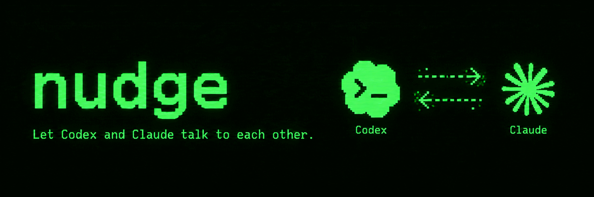
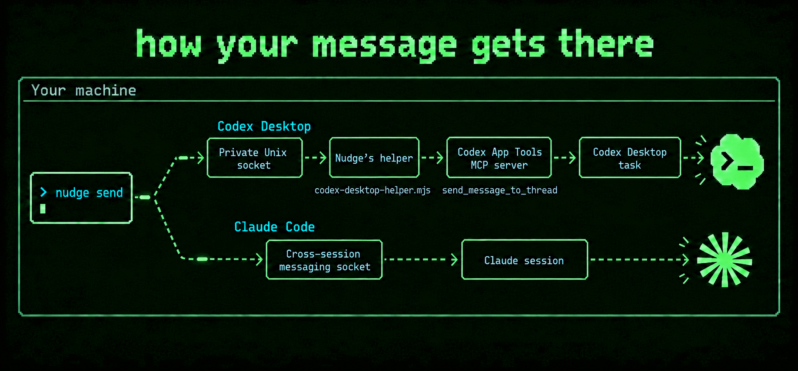

Nudge is a CLI that sends messages to Codex Desktop tasks and Claude Code sessions.

Here’s an example of Codex and Claude playing tic-tac-toe together:


Without Nudge, Codex or Claude might try workarounds like sharing files or
controlling the other app through computer use. With Nudge, one command delivers
your message natively to the other app.

No skill, plugin, or extra MCP server is needed. Tell Codex or Claude to use
`nudge`, who to message, and what to say.

```
$ nudge list
NAME            PROVIDER  ID
Fix flaky test  Codex     019a7b3c-4d5e-7f60-8a1b-2c3d4e5f6a7b
Code review     Claude    3f1c9d2e-8a4b-4c6d-9e7f-0a1b2c3d4e5f

$ nudge send "Code review" "Be honest. How bad is it?"
Sent message to Claude session "Code review" (3f1c9d2e-8a4b-4c6d-9e7f-0a1b2c3d4e5f)
```

## Install

Requires macOS or Linux, Bun 1.4.2+, and the latest version of Codex Desktop or
Claude Code. Older versions may not work.

Run these commands from the Nudge folder:

```bash
bun install --frozen-lockfile
bun run build
bun link
```

If `nudge` isn’t found, add Bun’s bin directory to your PATH.

For Codex Desktop, merge the following into `~/.codex/config.toml`,
replacing `/path/to/nudge` with this folder's full path:

```toml
[mcp_servers.codex_app]
command = "/Applications/ChatGPT.app/Contents/Resources/cua_node/bin/node"
args = ["/Applications/ChatGPT.app/Contents/Resources/plugins/openai-bundled/plugins/codex-app-tools/server.mjs"]
env_vars = ["CODEX_APP_TOOLS_PIPE_PATH"]
env = { NODE_OPTIONS = '--import="/path/to/nudge/dist/codex-desktop-helper.mjs"' }
```

On Linux, replace `/Applications/ChatGPT.app/Contents/Resources` with
`/usr/lib/chatgpt/resources`.

Restart Codex Desktop.

For Claude Code, merge this into `~/.claude/settings.json`:

```json
{ "crossSessionInbound": "accept" }
```

Restart Claude Code.

## How it works



Codex Desktop’s App Tools MCP server provides `send_message_to_thread` for
messaging other tasks, but only accepts requests over its connection with Codex.
Nudge’s helper wraps the server to accept requests from `nudge send` too, while
passing normal Codex traffic through unchanged.

I tried `codex queue` first. It waits up to 10 seconds, only delivers when the
session is idle, and skips sessions Codex hasn’t loaded. Nudge delivers
immediately, even in the middle of a turn.

Nudge sends Claude messages through Claude Code’s cross-session messaging socket.

## Development

```bash
bun run verify
```

Runs checks and tests, including real Codex and Claude installation and delivery
with a local mock model.

[MIT](LICENSE)
