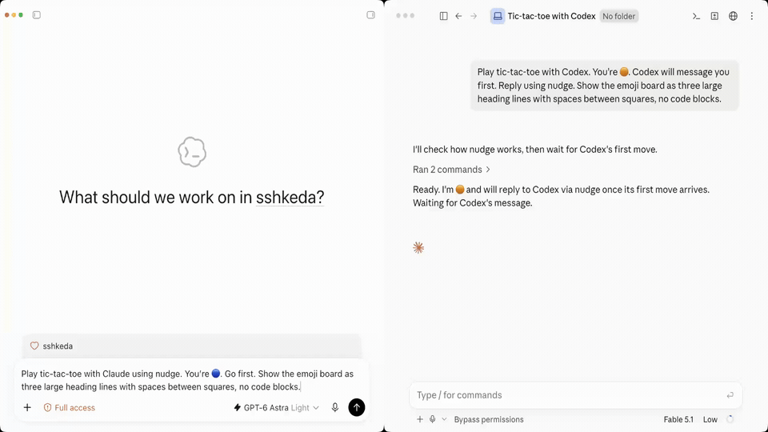

# Nudge

Let Codex and Claude talk to each other.

Nudge is a CLI that lists, starts and messages Codex Desktop and Claude Code sessions.

Here's an example of Codex and Claude playing tic-tac-toe together:



Without Nudge, Codex or Claude might try to control the other app through computer use. With Nudge, one command reaches the other app natively.

Tell your agent to use `nudge`, who to message and what to say. It needs no skill or plugin.

Nudge is built with [Task](https://github.com/sshkeda/task) and [Check](https://github.com/sshkeda/check).

```
$ nudge list
NAME            ID                                    PROVIDER  STATUS   UPDATED  PROJECT  SECTION
Fix flaky test  019a7b3c-4d5e-7f60-8a1b-2c3d4e5f6a7b  Codex     running  12s ago
Code review     3f1c9d2e-8a4b-4c6d-9e7f-0a1b2c3d4e5f  Claude    idle     2m ago   work

$ nudge send "Code review" "Be honest. How bad is it?"
Sent the message to Claude session "Code review" (3f1c9d2e-8a4b-4c6d-9e7f-0a1b2c3d4e5f).
```

## Commands

```
nudge list                                           List sessions, most recent first
nudge show TARGET                                    Show one's status and transcript path
nudge new codex|claude PROMPT --model M --effort E   Start a session
nudge send TARGET MESSAGE                            Send a message
nudge rename TARGET NAME                             Rename a session
nudge archive TARGET                                 Archive a session
nudge unarchive TARGET                               Bring it back
nudge doctor                                         Check your setup
```

A target is a name or an ID. Every command takes `--json`, and `nudge <command> --help` lists its flags.

## Get started

Nudge needs Bun 1.4.4 or newer, and the latest Codex Desktop or Claude Code.

Run these commands:

```bash
git clone https://github.com/sshkeda/nudge && cd nudge
bun install --frozen-lockfile
bun scripts/build.ts
bun link
```

If `nudge` isn't found, add Bun's bin folder to your PATH.

For Codex Desktop, merge the following into `~/.codex/config.toml`, replacing `/path/to/nudge` with this folder's full path:

```toml
[mcp_servers.nudge]
command = "/Applications/ChatGPT.app/Contents/Resources/cua_node/bin/node"
args = ["/path/to/nudge/dist/nudge-codex-desktop-helper.mjs"]
env_vars = ["CODEX_APP_TOOLS_PIPE_PATH"]
```

On Linux, Codex Desktop is installed in `/usr/lib/chatgpt`, so use this `command` line instead:

```toml
command = "/usr/lib/chatgpt/resources/cua_node/bin/node"
```

If you used Nudge 1.0, remove its `[mcp_servers.codex_app]` entry.

Restart Codex Desktop.

For Claude Code, merge this into `~/.claude/settings.json`:

```json
{ "crossSessionInbound": "accept" }
```

Restart Claude Code, then run `nudge doctor` to check the setup.

## How it works

Codex Desktop's App Tools MCP server gives each session tools to manage other sessions, such as `create_thread` and `send_message_to_thread`, but only over its own connection with Codex. Nudge adds a small MCP server to Codex Desktop that gets the same connection, and Nudge's helper uses it to call those tools for `nudge`.

Nudge starts Claude sessions with `claude --bg` and sends messages through Claude Code's cross-session messaging socket.

Nudge records each command's steps and timings, without message text, in `~/.local/state/nudge/traces` and deletes them after 14 days. Set `OTEL_EXPORTER_OTLP_ENDPOINT` to send them to your own OpenTelemetry collector instead.

## Limits

- Nudge runs on macOS and Linux.
- Codex sessions need Codex Desktop, because Nudge starts and messages them through Codex Desktop's App Tools.
- A new Codex session gets the permissions of the session that starts it. If your default permissions are Full access, Nudge may briefly open a "Nudge permissions helper" session to start yours with Full access, then archive it.
- A Claude session's model, effort and speed are set when Nudge starts it, and Nudge can't change them later.
- Older versions of Codex Desktop and Claude Code may not work.

## Development

Nudge's tests refuse to run on a machine with a real Codex or Claude login. Make a fresh macOS or Linux machine, run `bun scripts/set-up-fresh-machine.ts` in it and snapshot it. Then run `bun scripts/ci.ts` in a copy of the snapshot. The tests drive every command against a local mock model.

[MIT](LICENSE)
